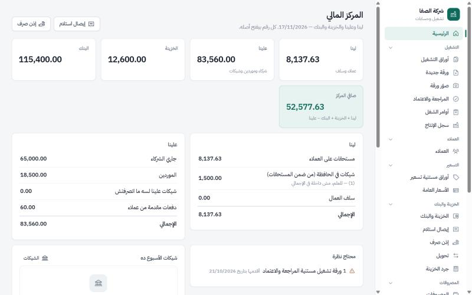
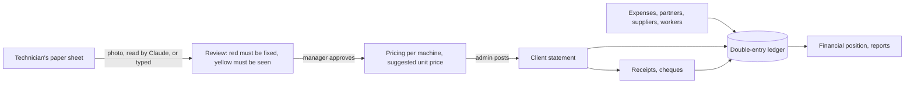
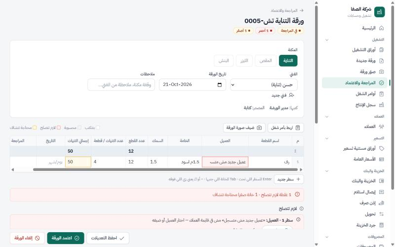
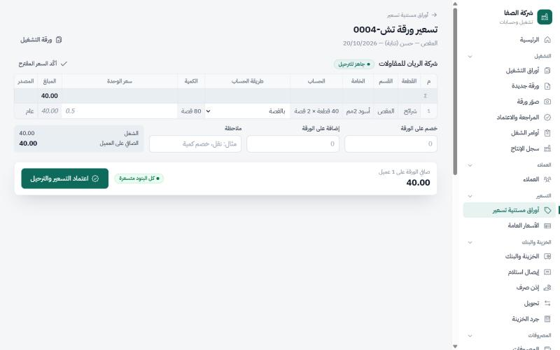
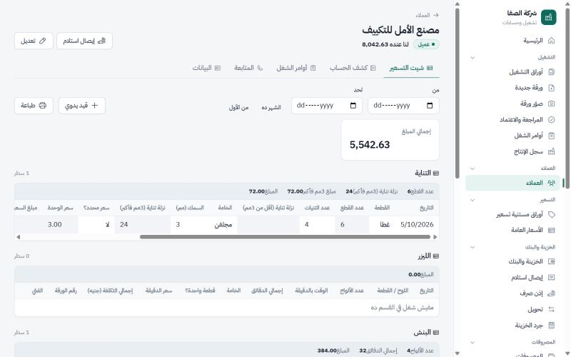
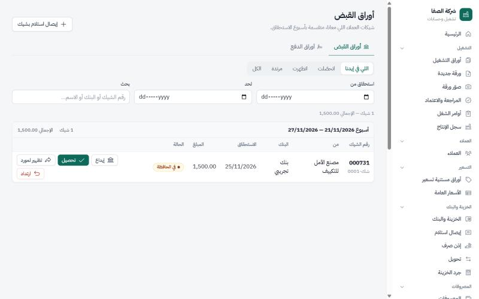

# شركة الصفا — Workshop Operations & Accounting

**From the technician's handwritten sheet to the client's statement.**
An offline-first, Arabic (RTL) web app that runs a real sheet-metal workshop in Egypt: it records the daily
machine sheets the technicians write by hand, prices the work per client and machine, and keeps the full
books — clients, partners, suppliers, workers, cash, bank, cheques and expenses — on a double-entry ledger.

It replaced a 38-sheet Excel workbook. The import reproduces every balance of that workbook to the piastre.



## Why it exists

The workshop ran on paper and Excel. Each technician fills a daily sheet per machine (press brake, shear, laser,
punch) for several clients at once. Someone copied those sheets into a workbook, priced them with per-client
rates, and kept statements by hand. Copying templates for each new client, totals that silently stopped at row 600,
dates typed three different ways and a cash figure that ignored the partners' money made the numbers hard to trust.

The app keeps the technicians' paper exactly as it is and automates everything after it.

## How it works



| | |
|---|---|
|  |  |
| **Review gate.** The grid has the paper's own columns; red issues block approval, yellow ones must be visited. | **Pricing a sheet.** Every line gets a suggested unit price from the client's history; one click posts it. |
|  |  |
| **Client pricing sheet.** The workbook's six sections, same columns, linked back to each technician sheet. | **Cheques.** Grouped by due week, with deposit / collect / endorse / bounce. |

## Features

- **Operations** — technician sheets with the original paper columns per machine; Excel-like entry grid
  (Arabic or Western digits, `~` and `//` for "same as above"); photo upload read by the Claude API into lines
  (server-side job queue, retries, works offline as plain manual entry); review and approval gate;
  optional work orders; production log.
- **Pricing** — the workbook's formulas per machine (bends with two thickness bands, cuts, laser/punch minutes with
  one extra minute per sheet and a minimum charge, louvers, sheet weight from density × size); variable unit price
  suggested from the last price used; one-click posting per sheet; price corrections by reversal, never by editing.
- **Accounting** — double-entry ledger in integer millimes; statements with debit / discount / credit / balance;
  receipts in cash, transfer, InstaPay, wallet or cheque; payment vouchers with cost centers (general, client, or
  split) and recharge to the client; partners' current accounts; supplier credit; worker advances; cash ↔ bank
  transfers; cash counts; recurring monthly expenses; month lock.
- **Cheques** — incoming and outgoing, by due week, alerts three days before due.
- **Reports** — financial position (what we're owed / what we owe / cash / bank / net), client summary, debt aging,
  monthly profit, four-week cash-flow forecast, partners, production, audit log, collection follow-ups.
- **Excel import** — maps the old 38-sheet workbook (two template generations, linked statements, synced logs) into
  the ledger with a preview of every judgment call and a reconciliation table; idempotent, with rollback.
- **Two roles** — the owner sees everything; the workshop manager records and approves work but never receives a
  single money field (stripped on the server, checked by a test that crawls every endpoint as the manager).
- **Runs on one Windows PC** — bundled Node, Inno Setup installer, an update button that pulls GitHub releases and
  rolls back by itself if a new version fails to start, daily backups, phone access through a Cloudflare tunnel + QR.

## Engineering notes

- **Money is never a float.** Amounts are integer millimes (1 EGP = 1000); rounding happens once, at the line.
- **Every balance comes from the ledger.** Each document posts one balanced transaction; posted transactions are
  never edited or deleted — a correction is a reversal plus a new posting, with a reason, and everything is audited.
- **Permissions, not roles,** enforced on the server; money is stripped from responses by field name.
- **Modular build.** Operations, pricing, treasury, reports and import each own their files and migration range
  (`src/migrations/*.js`), on top of a shared foundation (ledger, money, grid, statement, UI kit).
- **No framework, no build step.** Express + better-sqlite3 (WAL) on the server; vanilla ES modules, one design
  system and inline Phosphor icons on the client.
- **Tested.** 196 tests (`node --test`), including an end-to-end run from a technician's sheet to the financial
  position, the pricing formulas, the cheque lifecycle, month locks, the importer on a synthetic workbook, and the
  staff money-leak crawl. CI runs them on every push and builds the Windows installer.
- **Public repo, private data.** `scripts/check-repo.js` refuses data files, spreadsheets and known real figures.

## Run it

Requires Node 20+.

```bash
npm install
npm run demo
```

Open http://localhost:4300 and sign in as `admin` / `demo1234` (sees money) or `manager` / `demo1234` (doesn't).
The demo uses invented clients and amounts in `demo-data/`; delete that folder to start over.

```bash
npm test
```

`npm start` runs the real app (first visit creates the admin). Optional: add a Claude API key in
الإعدادات → القراءة الآلية to read photographed sheets.

## Project layout

```
src/ledger.js, money.js          double-entry ledger, integer money, money stripping
src/operations/  pricing/  treasury/  reports/  import/
src/routes/                      one router per module
src/migrations/                  schema, one file per module
public/js/grid.js, statement.js  Excel-like grid and the statement view shared by all modules
public/js/modules/               the screens
test/                            node --test suites, incl. e2e.test.js
installer/, scripts/, .github/   Windows installer, packaging, CI release
```

---

Built by Kaream Adel for the family workshop. The UI is in Egyptian Arabic; this README is in English for readers
outside it.
