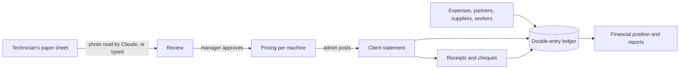

# Sheet Metal Management

[](https://github.com/kaream1adel/Sheet-Metal-APP/actions/workflows/release.yml)


Operations and accounting for a sheet-metal workshop, from the technician's handwritten sheet to the client's
statement. It runs a real family workshop in Egypt and replaced a 38-sheet Excel workbook.


## The problem

Technicians write a daily sheet per machine (press brake, shear, laser, punch) covering several clients. Those
sheets were copied into Excel by hand, priced with per-client rates, and turned into statements. The result was
slow, and hard to trust: totals stopped at fixed rows, dates were typed three ways, and the cash figure left out the
partners' money.

**The app keeps the technicians' paper exactly as it is and automates everything after it.**



## Screens

| | |
|---|---|
|  |  |
| **Review.** Same columns as the paper. Red issues block approval; yellow ones must be checked. | **Pricing.** Each line gets a suggested unit price from the client's history. One click posts it. |
|  |  |
| **Client pricing sheet.** The workbook's six sections, each line linked to its technician sheet. | **Cheques.** Grouped by due week, with deposit, collect, endorse and bounce. |

## Features

- **Technician sheets.** The paper's own columns per machine, in an Excel-like grid that accepts Arabic or Western
  digits and "same as above" marks. A photo of a sheet can be read into lines by the Claude API (server-side queue
  with retries); manual entry always works offline.
- **Pricing.** The workbook's formulas per machine: bends in two thickness bands, cuts, laser and punch minutes with a
  minimum charge, louvers, and sheet weight from density and size. Unit prices are suggested from the last price used.
- **Accounting.** Client statements with debit, discount, credit and balance; receipts in cash, transfer, InstaPay,
  wallet or cheque; expenses charged to the business, a client, or split; partners, suppliers, worker advances;
  separate cash and bank; recurring expenses; month lock.
- **Reports.** What we're owed and what we owe, client summary, debt aging, monthly profit, four-week cash forecast,
  production, and an audit log.
- **Excel import.** Brings the old workbook into the ledger with a preview of every judgment call and a
  reconciliation table. Re-runnable, with rollback.
- **Two roles.** The owner sees everything. The workshop manager records and approves work but never receives a
  money field.
- **Ships as a Windows app.** Bundled Node, an installer, a one-click update from GitHub releases that rolls back on
  failure, daily backups, and phone access through a Cloudflare tunnel.

## Engineering

- **No floating-point money.** Amounts are integer millimes (1 EGP = 1000), rounded once per line.
- **One source of truth.** Every balance comes from a double-entry ledger. Posted entries are never edited or
  deleted; a correction is a reversal plus a new entry, with a reason, and all of it is audited.
- **Security on the server.** Permission checks per route, and money fields are stripped from every response sent to
  staff. A test signs in as the manager, crawls every endpoint, and fails if any amount leaks.
- **Modular.** Operations, pricing, treasury, reports and import each own their routes, screens and migrations on a
  shared core (ledger, money, grid, statement view).
- **Small stack.** Express and SQLite (better-sqlite3, WAL) on the server; vanilla ES modules on the client; no
  framework and no build step.
- **Tested.** 194 tests with `node --test`, including an end-to-end run from a technician's sheet to the financial
  position. CI runs them on every push, then builds the Windows installer and publishes the release.
- **Public code, private data.** `scripts/check-repo.js` blocks data files, spreadsheets and known real figures
  from being committed.

## Run it

Requires Node 20 or newer.

```bash
npm install
npm run demo
```

Open http://localhost:4300 and sign in as `admin` / `demo1234` (sees money) or `manager` / `demo1234` (doesn't).
The demo runs on invented clients and amounts in `demo-data/`; delete that folder to start over.

```bash
npm test
```

`npm start` runs the app on a fresh database; the first visit creates the admin account.

## Project layout

```
src/ledger.js, money.js          double-entry ledger and integer money
src/operations/ pricing/ treasury/ reports/ import/
src/routes/                      one router per module
src/migrations/                  schema, one file per module
public/js/                       client: grid, statement view, screens in modules/
test/                            node --test suites
installer/  scripts/  .github/   Windows installer, packaging, CI release
```

---

Built by Kaream Adel. The interface is in Egyptian Arabic.
